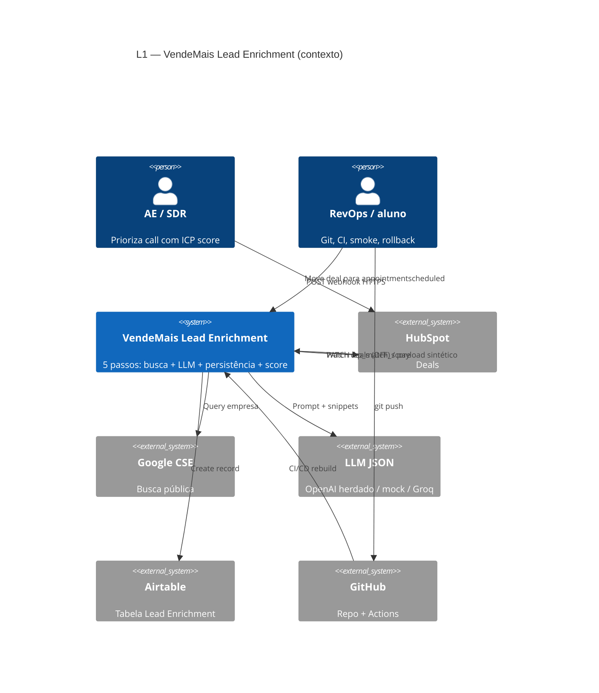
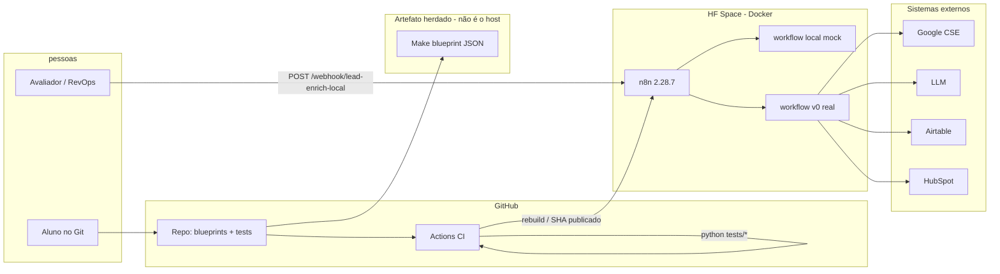
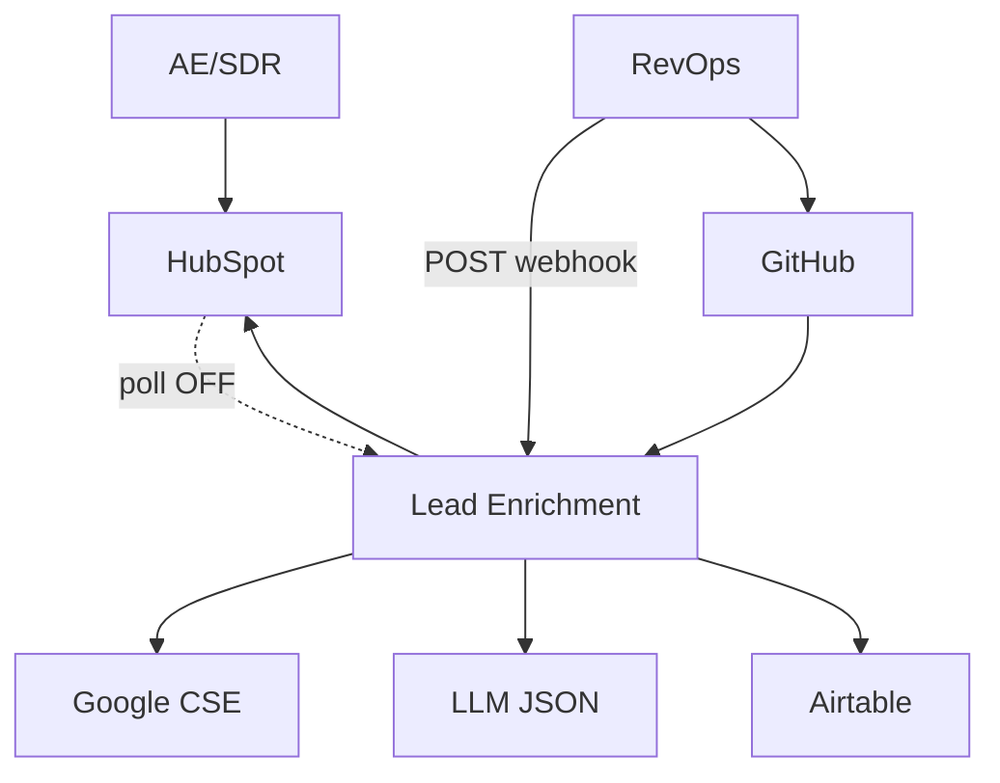

# Guia C4 — VendeMais Lead Enrichment (Etapa 1)

Desenhe **só** o que o sistema publicado realmente faz. Não coloque Vercel, Neon ou Slack “para enfeitar”.

Ferramenta: **Excalidraw** (entrega PNG em `docs/c4/`) **e** Mermaid abaixo (o avaliador lê no GitHub).

Convenção C4: caixas = pessoas/sistemas; setas = protocolos + o que viaja (sem credencial).

---

## Nível 1 — System Context

**Pergunta:** quem usa, e com quais sistemas externos o VendeMais Enrichment conversa?

### Componentes obrigatórios (caixas)

| Tipo C4 | Nome na caixa | Por quê (VendeMais) |
| ------- | ------------- | ------------------- |
| Person | AE / SDR VendeMais | Consome `icp_match_score` no deal |
| Person | RevOps (você) | Opera Git, CI, n8n, rollback |
| Person | Estagiária Joana (legado) | Só se quiser mostrar dívida de identidade — opcional, pontilhado “fora do runtime atual” |
| Software System (este) | **VendeMais Lead Enrichment** | O sistema que você publica |
| External | HubSpot CRM | Origem do deal / destino do score |
| External | Google Custom Search | Snippets da empresa |
| External | LLM (OpenAI herdado *ou* Groq/HF no demo) | JSON de enrichment |
| External | Airtable `Lead Enrichment` | Persistência herdada |
| External | GitHub | Fonte da verdade + Actions |

**Não desenhar no L1:** cada node do n8n, Docker, Secrets, Make vs n8n. Isso é L2.

### Fluxos (setas)

1. AE atualiza estágio do deal → HubSpot.
2. *No Make original:* HubSpot → sistema (poll). *No demo Etapa 1:* RevOps/avaliador → sistema via HTTPS POST (webhook) com empresa fictícia — **desenhe as duas setas**, a do poll pontilhada “OFF / dívida O1”.
3. Sistema → Google CSE.
4. Sistema → LLM.
5. Sistema → Airtable.
6. Sistema → HubSpot (update score).
7. RevOps → GitHub (push); GitHub → sistema (deploy).

### Mermaid (colar no Excalidraw via plugin ou renderizar no README)



Se o renderer C4 falhar no GitHub, use o fallback `graph TB` do final deste arquivo.

---

## Nível 2 — Container (dentro de “VendeMais Lead Enrichment”)

**Pergunta:** quais processos/artefatos você de fato hospeda?

### Containers obrigatórios

| Container | Tecnologia | Responsabilidade |
| --------- | ---------- | ---------------- |
| **n8n Runtime** | Docker `n8nio/n8n:2.28.7` no **HF Space** (fallback Render) | Executa workflows; expõe webhook |
| **Workflow offline** | `vendemais-enrich-local.json` | Smoke $0 (Code nodes mock) |
| **Workflow mirror** | `vendemais-enrich-v0.json` | Mesmos 5 nodes “de verdade” |
| **Blueprint Make** | `vendemais-make-blueprint.json` | Contrato herdado versionado (**não** é processo no Space, é artefato Git) |
| **CI runner** | GitHub Actions | Valida JSON + testes de lógica |
| **Secrets store** | HF Space Secrets / GitHub Secrets | Chaves fora do Git |
| **Airtable** (externo já no L1; no L2 pode repetir como cilindro) | SaaS | Só se o workflow v0 estiver ativo |

### Relacionamentos L2 para desenhar

```
Avaliador/RevOps
    --HTTPS POST /webhook/lead-enrich-local--> n8n Runtime
n8n Runtime --lê--> Workflow offline
n8n Runtime --lê--> Workflow mirror (se secrets ok)
GitHub --Actions python tests--> CI (pass/fail)
GitHub --deploy/rebuild--> n8n Runtime
n8n Runtime --HTTPS--> Google CSE / LLM / Airtable / HubSpot
Dev --commit--> Git (blueprint Make + n8n JSON)
```

**Faça um container pontilhado “Make.com (conta corporativa — não é o host Etapa 1)”** ligando só ao blueprint no Git. Isso prova que você **não reescreveu** nem **fingiu** que o Make está no ar.

### Componentes *dentro* do n8n (opcional, ainda L2 se o diagrama não poluir)

Cinco caixas na horizontal, iguais ao Make:

1. Trigger Lead (Webhook)  
2. Google Custom Search (HTTP)  
3. OpenAI / Code mock  
4. Airtable Append / mock  
5. HubSpot Update / mock  

### Mermaid L2



---

## Nível 3 — **não entregue** na Etapa 1

Component (código de cada node) só se sobrar tempo. Autônomo pede L1+L2 consistentes com o deploy, não UML de classe.

---

## Checklist de qualidade do desenho (rubrica)

- [ ] L1 tem **pessoas** e **sistemas externos nomeados** (HubSpot, Google, LLM, Airtable, GitHub).
- [ ] Poll HubSpot está **pontilhado / OFF**.
- [ ] L2 distingue **Make (artefato)** vs **n8n (processo no Space)**.
- [ ] Nenhuma caixa “Vercel backend”.
- [ ] Arquivos: `docs/c4/l1-context.png` e `docs/c4/l2-container.png` + este Markdown.

---

## Fallback GitHub (sem plugin C4)


